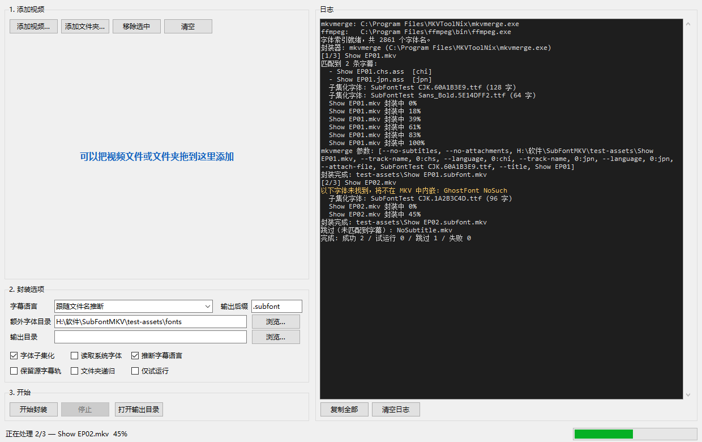

# SubFontMKV

把**外挂字幕和字体软封装进 MKV**：字幕成为可开关的软字幕轨，字体作为附件（attachment）内嵌，
播放器会优先使用内嵌的子集字体，因此在任何机器上都能正确显示字幕样式。

本项目在 GitHub 上现有的同类项目基础上修改而成，基础项目为
**[DYY-Studio/AddSubFontMKV_py](https://github.com/DYY-Studio/AddSubFontMKV_py)**（Apache-2.0）。
源码经由 `https://git.tangbai.cc` 代理获取。基础项目快照放在本地 `third_party/AddSubFontMKV_py/` 目录
（属于第三方代码，未纳入版本管理），可随时用 `python tools/fetch_base.py` 重新拉取。

---

## 为什么选择这个基础项目

调研过 GitHub 上的同类项目：

| 项目 | 语言 | 说明 | 是否采用 |
| --- | --- | --- | --- |
| [DYY-Studio/AddSubFontMKV_py](https://github.com/DYY-Studio/AddSubFontMKV_py) | Python | 字体子集化 + mkvmerge/ffmpeg 封装，逻辑最完整 | ✅ **基础项目** |
| [MkvAutoSubset/MkvAutoSubset](https://github.com/MkvAutoSubset/MkvAutoSubset) | Go | 功能强但需编译，体积大（78MB） | ✖ |
| [DYY-Studio/AddSubFont-to-MKV](https://github.com/DYY-Studio/AddSubFont-to-MKV) | Batch | 该项目的前身，已被取代 | ✖ |
| [Danyuyuyuyu/mux-deck](https://github.com/Danyuyuyuyu/mux-deck) | JS/Python | Web UI，较重 | ✖ |

选它的原因：**字体子集化 + 名称改写（CRC32 后缀）** 的方案已经过长期验证，能避免播放器错误地
使用系统里同名的完整字体。

## 相对基础项目的改动

原项目是 PyQt5 GUI、强依赖 Windows 注册表，且用 `os.system` 拼接命令行。本项目在其思路基础上重写：

1. **库 + CLI 分离**，去掉 PyQt5 / colorama 等硬依赖，跨平台可用（Windows / Linux / macOS）；
   字幕编码识别优先用 `charset-normalizer`，其次 `chardet`，都没有时用内置启发式。
2. **纯 Python 字体扫描**，不再依赖 Windows 注册表，改用 `fontTools` 直接读取字体表。
3. **`subprocess` 调用外部程序**，杜绝 `os.system` 的引号转义与命令注入问题，路径含空格/中文也安全。
4. **修复原项目缺陷**：
   - 子集字体文件名产生 `Name.ttf.ttf` 双扩展名；
   - 字幕语言使用 `zh-Hans` 等 BCP-47 标签，mkvmerge 会直接报错 —— 改用 ISO-639-2（`chi`/`jpn`）；
   - 同一字幕因搜索目录重复而被匹配多次，导致封装出重复字幕轨；
   - ffmpeg 回退路径会把完整临时路径写成附件名。
5. **新增能力**：
   - **Tkinter 图形界面**（支持拖拽、后台线程、实时日志、进度条）；
   - **字幕匹配预检**：添加文件时即标红提示哪些视频找不到外挂字幕；
   - `--dry-run` 试运行、`--json` 机器可读输出、分级日志（`-q`/`-v`）；
   - 依据文件名自动推断字幕语言与轨道标题（`chs`/`tc`/`jpn` …）；
   - `--no-subset` 直接内嵌完整字体、`--no-system-fonts` 加速启动；
   - mkvmerge 与 ffmpeg 双后端自动选择与回退。
6. **CLI 与 GUI 共用同一套流程**（`core` 里的 `Planner` / `Processor`），两条路径行为完全一致，不会各改各的。
7. **跳过自己的产物**：扫描目录时忽略文件名带 `--suffix` 的 MKV，避免对库目录反复执行
   `--recursive` 时把上次的输出再封装一遍（显式指定的文件不受影响）。
8. **拖入文件不卡顿**：字幕匹配按目录缓存清单，并把匹配热路径改成纯字符串比较，
   一次拖入上百个视频时不再为每个视频重复扫描同一目录（实测约快 12 倍）；
   拖拽高亮只在状态真正变化时才重绘，拖动过程中的大量事件不会造成界面卡顿。
9. **实时进度**：封装过程逐行读取 mkvmerge 的输出，进度条与状态栏会**实时**显示
   当前文件与百分比（例如「正在处理 2/5 — Show EP01.mkv  45%」），日志里也会同步打印
   `封装中 45%`。之前用 `subprocess.run()` **要等进程结束才拿到全部输出**，所以进度是
   一次性蹦出来的、看起来像没有进度。
10. **日志自动换行**：日志框用 `wrap="word"`，超长的 mkvmerge 命令行与完整路径
   自动折行，不再需要横向滚动（实测折行带来的缩放开销仅约 +2.5%）。
11. **日志不再拖慢界面**：
   - 日志改为**批量写入**（原来是逐行 `insert` + `see`，3000 行要 8.7 秒，现在 0.008 秒）；
   - 日志控件**只保留最近 600 行**，界面里的行数不再随时间无限增长；
   - **只在视图贴底时自动滚动**，往上翻看历史时不会被强行拽回底部；
   - 后台日志积压超过 4000 条会丢弃并提示，避免刷屏把界面拖死。

> 以下是本项目**自己修掉的原项目/实现缺陷**（都有对应的回归测试，见 [tests/run_tests.py](tests/run_tests.py)）：
>
> - 子集化时按「标签名 + 其余内容」切分覆盖标签 —— 否则 `{\\rNote}` 会被贪婪地读成名为
>   `rNote` 的标签，导致该行文字被算到错误的字体上；
> - `\\p1` 绘图指令的坐标不应计入字体字符集，`Comment` 行同理；
> - TTC/OTC 多个 face 共用一个文件 reader，逐个 `close()` 会让其余 face 报
>   `seek of closed file`；改为统一收口；
> - 子集化输出的扩展名按 sfnt 类型（`.ttf`/`.otf`）给，而不是沿用源文件的 `.ttc`；
> - 重复对同一份字幕子集化时，注释与字体名不会层层叠加（从 `; Font Subset` 注释还原原名）；
> - 字幕匹配只允许在视频名后追加**语言标签/版本标记**，避免 `Show.mkv` 误吃其他集数的字幕。

## 安装

直接使用（推荐）：把仓库放好，装好 `fontTools` 后运行 `运行界面.bat` 或
`python -m subfontmkv` 即可，无需安装。

也可以装成命令：

```bash
pip install .            # 提供 subfontmkv 命令
pip install .[gui]       # 额外装 tkinterdnd2，启用拖拽
```

## 环境要求

- Python 3.7+
- `fontTools`：`pip install fonttools`
- `tkinterdnd2`（可选）：`pip install tkinterdnd2` —— 仅用于图形界面的**拖拽添加**功能
- `chardet`（可选）：字幕编码识别；未安装时用内置的启发式判断
- **mkvmerge**（推荐）：安装 [MKVToolNix](https://mkvtoolnix.download/)，或放在 PATH 中；
  程序也会自动查找 `C:\Program Files\MKVToolNix\mkvmerge.exe`
- **ffmpeg**（可选，mkvmerge 缺失时回退使用）

## 图形界面（推荐新手）

双击 **`运行界面.bat`**，或执行：

```bash
python -m subfontmkv.gui
# 也可以直接写 subfontmkv gui
```

界面为**左操作 + 右日志**两栏布局：

**左栏**

1. **添加视频** —— 把视频文件或文件夹**直接拖到「添加视频」这一整块区域**即可添加
   （可一次拖多个，含空格的中文路径也没问题）；也可以用「添加视频…/添加文件夹…」按钮。

   列表为空时，列表位置上会显示一行**蓝色提示文字**「可以把视频文件或文件夹拖到这里添加」；
   **一旦加入文件，提示就被真正的列表替换**，清空列表后提示重新出现。拖动经过时整块区域
   会变浅蓝高亮。列表支持多选，双击或按 Delete 可移除。

   **列表会自动预检字幕匹配情况，并以颜色区分：**

   | 颜色 | 含义 |
   | --- | --- |
   | 🔴 红色加粗 | **未匹配到字幕**（0 条）—— 该视频不会被封装，请检查字幕文件名 |
   | 🟢 绿色 | 已匹配到字幕，可以封装 |
   | 黑色 | 普通行（尚未预检） |

   添加文件夹时会自动展开出里面的每个视频，逐个判定；如果某个文件夹里没有视频，
   会在日志里给出提示。列表右侧还有「匹配字幕 / 状态」两列，底部汇总会提示
   「其中 N 个未匹配到字幕」。
2. **封装选项** —— 字幕语言、输出后缀、额外字体目录，以及子集化/系统字体/轨道命名/
   递归/保留源轨道/试运行等开关。
3. **开始** —— 开始 / 停止 / 打开输出目录，下方是状态文字与进度条。

**右栏：日志**

实时显示探测结果、匹配到的字幕、子集化过程与封装命令。**超长的一行会自动换行**
（mkvmerge 命令行、带完整路径的日志都不会横向溢出，中文目录这种没有空格的
长串也能正确断开），只需垂直滚动条；另有「复制全部」「清空日志」按钮
（复制得到的是完整逻辑行，不会带上换行符）。

封装在后台线程执行，界面不会卡死，「停止」会在当前文件处理完后中断。

> 拖拽依赖可选包 `tkinterdnd2`（`pip install tkinterdnd2`）。未安装时界面其余功能
> 完全正常，只是拖拽不可用，此时提示会自动变为使用按钮添加。



## 命令行快速开始

```bash
# 处理单个视频（自动匹配同目录下的外挂字幕）
python -m subfontmkv "D:\Anime\Show EP01.mkv"

# 批量递归处理整个目录
python -m subfontmkv "D:\Anime" --recursive

# 指定额外字体目录 + 先试运行看看会做什么
python -m subfontmkv "D:\Anime" --font-dir "D:\Fonts" --dry-run
```

Windows 上也可以直接把文件/文件夹拖到 **`subfontmkv.bat`** 上。

## 常用参数

| 参数 | 说明 |
| --- | --- |
| `--font-dir DIR` | 额外字体目录，可重复 |
| `--sub-dir DIR` | 额外的字幕搜索目录，可重复 |
| `--output-dir DIR` | 输出目录，默认与视频同目录 |
| `--no-subset` | 不做子集化，直接内嵌完整字体 |
| `--no-system-fonts` | 不读取系统字体目录（启动更快） |
| `--language LANG` | 默认字幕语言，默认 `und` |
| `--no-infer-language` | 不从文件名推断语言 |
| `--muxer auto\|mkvmerge\|ffmpeg` | 指定封装器 |
| `--mkvmerge PATH` | 手动指定 mkvmerge 路径 |
| `--keep-source-subs` / `--keep-source-attach` | 保留源 MKV 里已有的字幕/附件（默认丢弃） |
| `--suffix .subfont` | 输出文件后缀 |
| `--dry-run` / `--json` / `-q` / `-v` | 试运行 / JSON 输出 / 静默 / 详细日志 |

完整列表见 `python -m subfontmkv --help`。

## 工作原理

1. **匹配字幕** —— 按「视频名 + 语言/版本标记」匹配同目录（或 `--sub-dir`）下的
   `.ass/.ssa/.srt/.vtt` 等，并对结果去重排序。
2. **解析字体需求** —— 读取字幕 `[V4+ Styles]` 段中每个样式使用的 `Fontname`，
   同时按 `\\fn` / `\\r` 覆盖标签把每行文本切段，算出**每种字体实际要用到哪些字符**
   （自动跳过 `Comment` 行与 `\\p` 绘图指令）。
3. **查找字体** —— 在视频目录 → `--font-dir` → 系统字体目录中按字体名查找，
   支持 TTC/OTC 中的单个 face，并按样式的 Bold/Italic 标志挑最合适的 face。
4. **子集化** —— 用 `fontTools` 只保留字幕实际用到的字符，并把字体内部名称改写为
   `原名.CRC32`（例如 `AgencyFB-Bold.302BD68C`）。
5. **重写字幕** —— 把 ASS 里引用的字体名同步改为 `原名.CRC32`，并在 `[Script Info]` 里
   留下 `; Font Subset: 新名 - 原名` 注释，便于下次处理时还原。
6. **封装** —— 用 mkvmerge 把字幕作为软字幕轨、字体作为附件写入 MKV；
   源文件里原有的字幕轨与附件默认丢弃（`--no-subtitles --no-attachments`），避免与新的重复。

第 4、5 步是关键：字幕引用的字体名与内嵌字体的内部名一致，播放器就一定会用上内嵌的字体。

## 项目结构

```
subfontmkv/
  ass.py      SSA/ASS 解析、字体需求分析、字体名改写
  fonts.py    字体索引与匹配、子集化、内部名称改写
  mux.py      mkvmerge / ffmpeg 后端与外部命令调用
  core.py     字幕匹配、任务规划、批量执行（CLI 与 GUI 共用）
  cli.py      命令行接口
  gui.py      Tkinter 图形界面
  log.py      分级日志
tests/
  run_tests.py   44 项回归测试（解析 / 匹配 / 字体 / 端到端封装 / CLI）
  test_gui.py    GUI 端到端测试（预检、线程、封装）
  fixtures/      测试用字幕
test-assets/     自包含的测试素材（合成视频、合成字体、字幕；由脚本生成）
tools/
  fetch_base.py       通过 git.tangbai.cc 代理重新拉取基础项目源码
  make_test_fonts.py  生成合成测试字体
  make_test_assets.py 生成批量/TTC 等测试素材
运行界面.bat / subfontmkv.bat   Windows 启动脚本
```

## 测试

```bash
# 先生成测试素材（合成视频 + 合成字体，不依赖本机字体）
python tools/make_test_fonts.py
python tools/make_test_assets.py

python -m unittest tests.run_tests -v     # 44 项回归测试
python tests/run_tests.py --quick         # 只跑解析/字体逻辑，不封装
python tests/test_gui.py                  # GUI 端到端（需要图形环境）
```

端到端部分会真实调用 mkvmerge 封装，再解封装校验：字幕轨语言是否为合法 ISO-639-2、
附件名是否带 CRC32、**内嵌字幕引用的字体名是否与附件字体内部名称完全一致**。
未安装 mkvmerge 时这部分会自动跳过。

测试素材是脚本生成的（见 `test-assets/`），包括合成视频与合成字体，因此不依赖机器上装了哪些字体。

## 验证

```bash
$ python -m subfontmkv "test-assets\Show EP01.mkv" --font-dir "test-assets\fonts"
字体索引就绪，共 9 个字体名。
封装器: mkvmerge (C:\Program Files\MKVToolNix\mkvmerge.exe)
[1/1] Show EP01.mkv
=== Show EP01.mkv ===
匹配到 2 条字幕:
  - Show EP01.chs.ass  [chi]
  - Show EP01.jpn.ass  [jpn]
  子集化字体: SubFontTest CJK.60A1B3E9.ttf (12 字)
  子集化字体: SubFontTest Sans_Bold.5E14DFF2.ttf (33 字)
封装完成: test-assets\Show EP01.subfont.mkv
完成: 成功 1 / 试运行 0 / 跳过 0 / 失败 0
```

用 `mkvmerge -i` 检查产物：

```
Track ID 0: video (MPEG-4p10/AVC/h.264)
Track ID 1: audio (AAC)
Track ID 2: subtitles (SubStationAlpha)      <- 软字幕，语言 chi，轨道名 chs
Track ID 3: subtitles (SubStationAlpha)      <- 软字幕，语言 jpn，轨道名 jpn
Attachment ID 1: type 'application/x-truetype-font', size 3664 bytes,
                 file name 'SubFontTest CJK.60A1B3E9.ttf'   <- 内嵌子集字体
```

内嵌字体内部的 Family 名同样是 `SubFontTest CJK.60A1B3E9`，与字幕里引用的名字一致，
所以播放器必然命中内嵌字体。

## 许可证

Apache License 2.0。原始项目 Copyright (c) 2022-2024 yyfll。
